# ProxLedger – Handbuch

ProxLedger zeigt auf einen Blick, welche Proxmox-Subscription zu welchem Host und zu welchem Kunden
gehört, wann sie ausläuft und ob die Rechnungen dazu erledigt sind. Auf jedem Host meldet ein kleiner
Agent einmal täglich seinen Status – das Dashboard fragt die Hosts nie aktiv ab und funktioniert deshalb
auch mit Hosts hinter NAT.

**Inhalt**

1. [Installation](#1-installation)
2. [Erste Anmeldung](#2-erste-anmeldung)
3. [Agent auf einem Host ausrollen](#3-agent-auf-einem-host-ausrollen)
4. [Hosts einem Kunden zuweisen](#4-hosts-einem-kunden-zuweisen)
4a. [Cluster](#4a-cluster)
5. [Kunden und Standorte pflegen](#5-kunden-und-standorte-pflegen)
6. [Laufzeiten und Rechnungen](#6-laufzeiten-und-rechnungen)
7. [Warnungen](#7-warnungen)
8. [Benachrichtigungen einrichten](#8-benachrichtigungen-einrichten)
9. [Exporte](#9-exporte)
10. [Sicherung und Aktualisierung](#10-sicherung-und-aktualisierung)
11. [Fehlersuche](#11-fehlersuche)

---

## 1. Installation

### Mit Docker

```bash
git clone <repository> proxledger && cd proxledger
cp .env.example .env
```

In der `.env` mindestens setzen:

| Wert | Bedeutung |
|---|---|
| `APP_SECRET` | Schlüssel für die Sitzungen, mindestens 32 Zeichen (`openssl rand -base64 48`) |
| `POSTGRES_PASSWORD` | Passwort der mitgelieferten Datenbank |
| `ADMIN_EMAIL`, `ADMIN_PASSWORD` | erster Zugang zum Dashboard |
| `APP_URL` | Adresse, unter der das Dashboard erreichbar ist |

Dann starten:

```bash
docker compose up -d
```

Beim ersten Start legt der Dienst `migrate` das Datenbankschema an und erzeugt den Administrator.

> **Wichtig:** `APP_URL` muss zur tatsächlichen Adresse passen. Davon hängt ab, ob das Sitzungs-Cookie als
> `Secure` markiert wird – bei falscher Angabe funktioniert die Anmeldung nicht.

### Auf einem Proxmox-Host als LXC-Container

```bash
bash deploy/lxc-installer.sh
```

Das Skript fragt Container-ID, Ressourcen und Netzwerk ab, legt einen Debian-Container an, installiert
Docker, holt den Quelltext, erzeugt Zufallspasswörter und startet alles. Am Ende stehen Adresse,
Benutzername und Passwort auf dem Bildschirm; das Passwort liegt zusätzlich in
`/root/proxledger-admin-passwort.txt` im Container.

Für den dauerhaften Betrieb gehört ein Reverse Proxy mit HTTPS davor – Beispiele für Caddy, nginx und
Traefik liegen in [`deploy/reverse-proxy/`](../../deploy/reverse-proxy/).

---

## 2. Erste Anmeldung

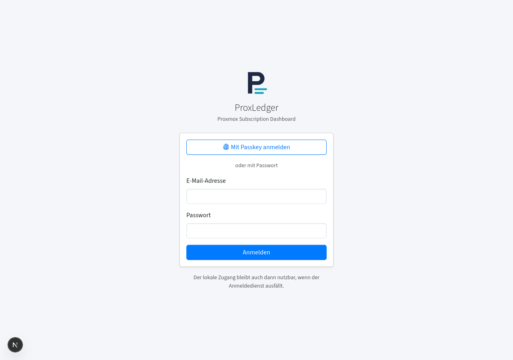

Anmelden mit der E-Mail-Adresse und dem Passwort aus der `.env`. Ist ein Anmeldedienst über OIDC
eingerichtet (`OIDC_ISSUER`, `OIDC_CLIENT_ID`, `OIDC_CLIENT_SECRET`), erscheint zusätzlich ein Knopf
„Mit authentik anmelden“. Der lokale Zugang bleibt absichtlich immer nutzbar – falls der Anmeldedienst
einmal ausfällt, kommst du trotzdem hinein.

Nach der Anmeldung landest du auf dem Dashboard:

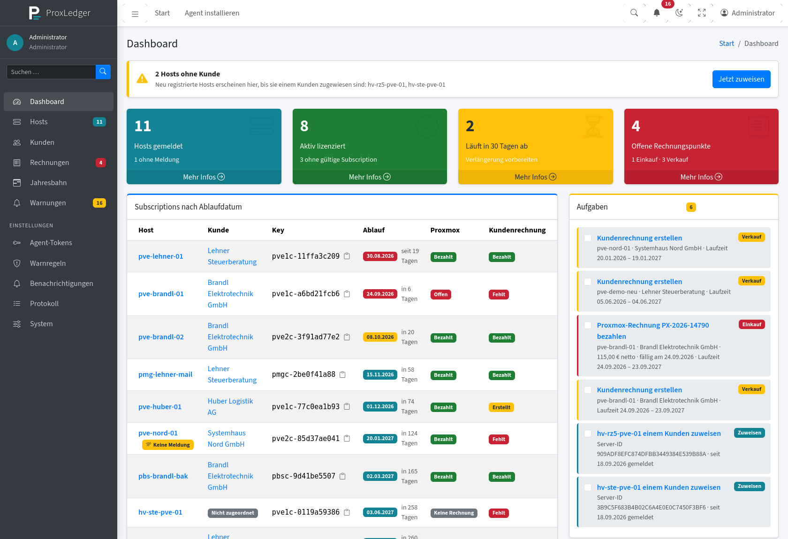

Von oben nach unten:

- **Vier Kacheln** mit den Kennzahlen: gemeldete Hosts, aktiv lizenziert, Ablauf innerhalb von 30 Tagen,
  offene Rechnungspunkte. Jede Kachel führt auf die passende gefilterte Liste.
- **Subscriptions nach Ablaufdatum:** die nächste Fälligkeit zuerst, mit Kunde, Key und beiden
  Rechnungsständen. Rot bedeutet weniger als 14 Tage, gelb weniger als 30.
- **Aufgaben:** was konkret zu tun ist. Das Häkchen setzt den Rechnungsstatus direkt.
- **Rechnungsstatus je Kunde:** wie viele Punkte je Kunde erledigt sind.

---

## 3. Agent auf einem Host ausrollen

Zuerst im Dashboard unter *Einstellungen → Agent-Tokens* einen Enrollment-Token erzeugen:

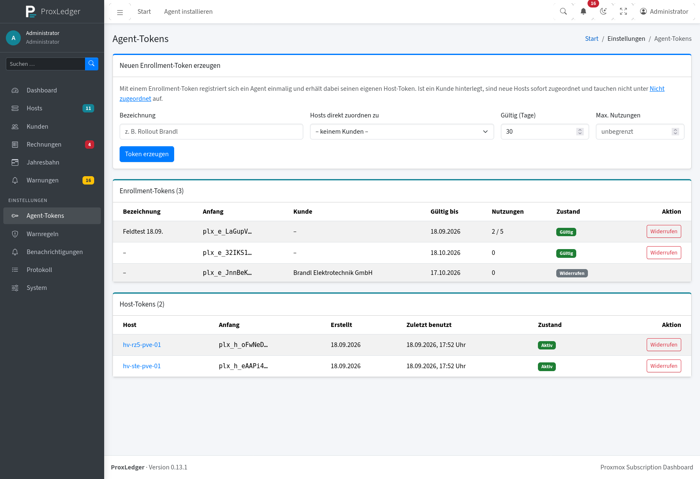

- **Bezeichnung:** wofür der Token gedacht ist, etwa „Rollout Brandl“.
- **Hosts direkt zuordnen zu:** Wird hier ein Kunde gewählt, gehören alle mit diesem Token registrierten
  Hosts sofort zu diesem Kunden – die spätere Zuweisung entfällt.
- **Gültigkeit und Nutzungen** begrenzen den Schaden, falls der Token verloren geht.

Der Token wird **nur einmal angezeigt**. Direkt darunter steht der fertige Befehl. Auf dem Proxmox-Host
als root ausführen:

```bash
curl -fsSL https://<dashboard>/install.sh | bash -s -- --token plx_e_…
```

Der Installer erkennt selbst, ob es sich um Proxmox VE, Backup Server oder Mail Gateway handelt,
registriert den Host, legt die Konfiguration unter `/etc/proxledger/agent.conf` (Rechte 600) ab,
richtet einen systemd-Timer ein und schickt sofort den ersten Report.

Nützliche Befehle auf dem Host:

| Befehl | Zweck |
|---|---|
| `proxledger-agent --test` | Verbindung zum Dashboard prüfen |
| `proxledger-agent --dry-run` | Report anzeigen, ohne ihn zu senden |
| `proxledger-agent` | Report sofort senden |
| `journalctl -t proxledger -n 50` | Protokoll ansehen |
| `systemctl list-timers proxledger.timer` | nächsten Lauf anzeigen |

Der Timer läuft täglich mit bis zu vier Stunden Zufallsversatz, damit nicht alle Hosts gleichzeitig melden.
Ist das Dashboard nicht erreichbar, versucht es der Agent dreimal mit wachsendem Abstand und legt den
Report danach in `/var/lib/proxledger/spool/` ab; beim nächsten Lauf wird er nachgesendet.

**Entfernen:**

```bash
curl -fsSL https://<dashboard>/install.sh | bash -s -- --uninstall
```

---

## 4. Hosts einem Kunden zuweisen

Neu registrierte Hosts ohne Kundenbindung erscheinen als Hinweis auf dem Dashboard und unter
*Hosts → Nicht zugeordnete*:

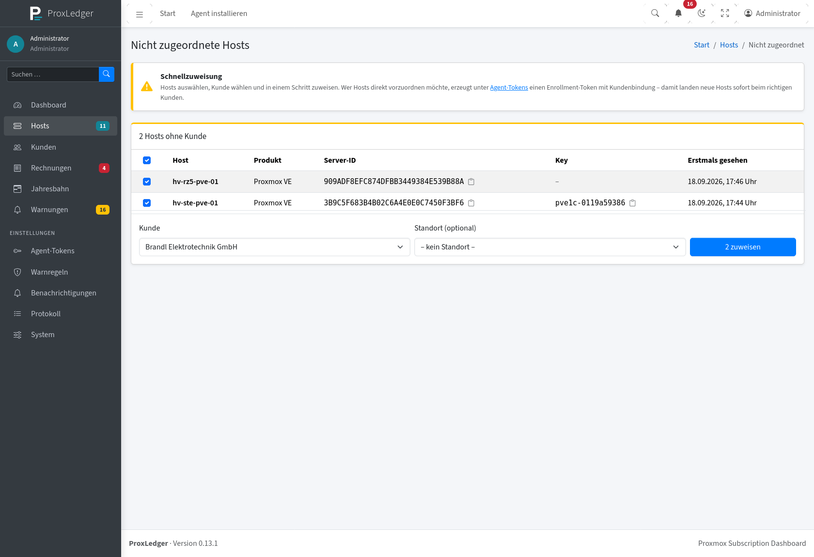

Mehrere Hosts auswählen, Kunde und optional Standort wählen, zuweisen – fertig. Die zugehörige Warnung
schließt sich dabei von selbst.

In der Host-Tabelle findest du jeden Host wieder:

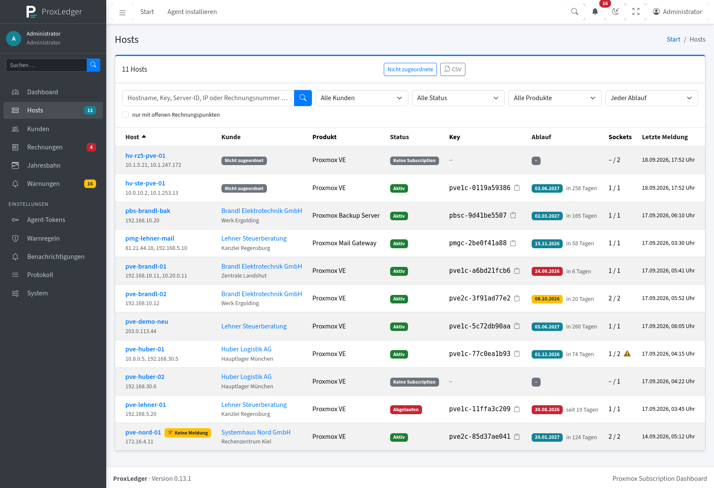

Die Suche greift auf Hostname, FQDN, Subscription-Key, Server-ID, IP-Adresse, Kundenname **und
Rechnungsnummer** zu. Die Eingabe von `pve1c-a6bd21fcb6` führt also direkt zum passenden Host samt Kunde –
genau die Zuordnung, die im Proxmox-Shop fehlt.

Alle Filter stehen in der Adresse: Eine gefilterte Liste lässt sich als Lesezeichen speichern oder
weitergeben, und der Zurück-Knopf funktioniert wie erwartet.

---

## 4a. Cluster

**In Proxmox hat jeder Knoten eine eigene Subscription** mit eigener Server-ID – ein Cluster mit drei
Knoten braucht drei Lizenzen und drei Agents. Ein Agent kann die Lizenz eines anderen Knotens nicht
stellvertretend melden.

Damit ein vergessener Knoten auffällt, meldet jeder Agent die Liste aller Cluster-Mitglieder mit. Das
Dashboard vergleicht sie mit den Hosts, die sich tatsächlich melden:

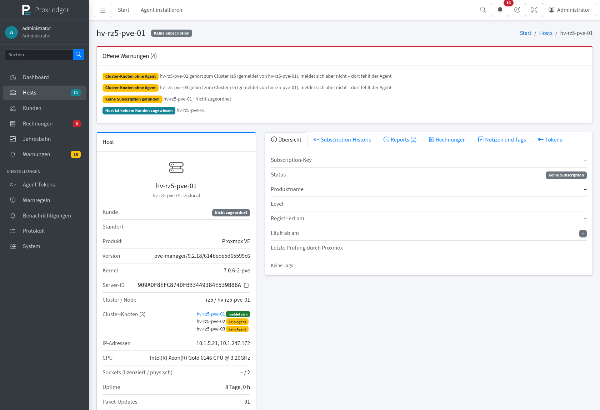

Hier laufen auf `hv-rz5-pve-02` und `hv-rz5-pve-03` noch keine Agents – das Dashboard sagt es zweimal
deutlich. Sobald dort installiert wird, schließen sich die Warnungen von selbst.

---

## 5. Kunden und Standorte pflegen

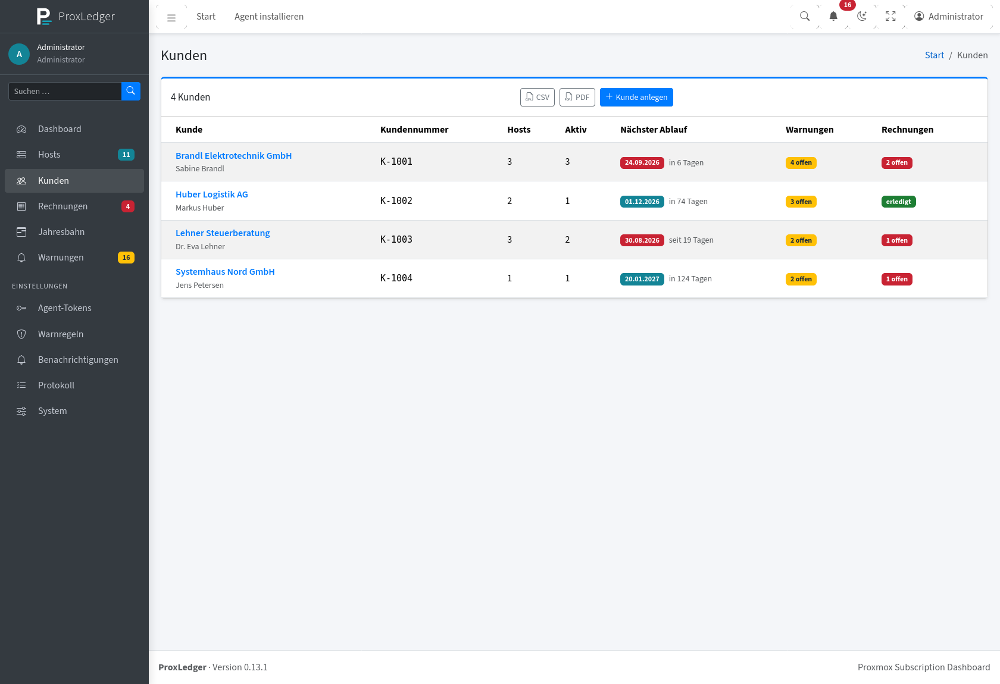

Die Übersicht zeigt je Kunde die Anzahl der Hosts, wie viele davon aktiv lizenziert sind, den nächsten
Ablauf, offene Warnungen und den Rechnungsstand.

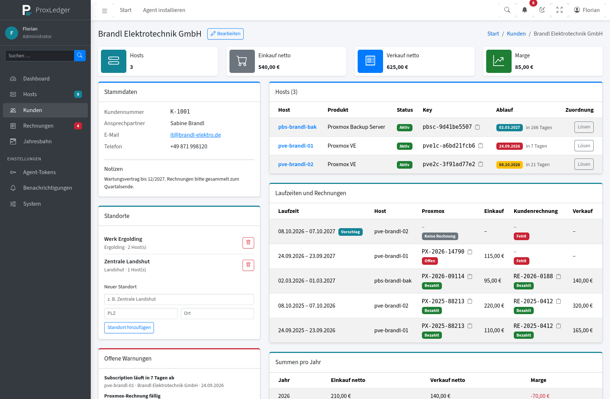

In der Detailansicht stehen Stammdaten, Standorte, alle Hosts, alle Laufzeiten und die Summen pro Jahr
mit Marge. Die vier Kästen oben fassen Hosts, Einkauf, Verkauf und Marge zusammen.

Standorte sind optional und lohnen sich bei Kunden mit mehreren Filialen: Sie erscheinen in der
Host-Tabelle und lassen sich bei der Zuweisung mit angeben.

---

## 6. Laufzeiten und Rechnungen

Eine **Laufzeit** ist ein Lizenzjahr eines Hosts, zum Beispiel 24.09.2026 bis 23.09.2027. Dazu gehören
zwei Rechnungen: die **Proxmox-Rechnung** (Einkauf) und die **Kundenrechnung** (Verkauf). Die Differenz
ist die Marge.

Meldet ein Agent ein neues Ablaufdatum, legt ProxLedger die passende Laufzeit automatisch als Vorschlag
an – du trägst nur noch die Rechnungsdaten ein.

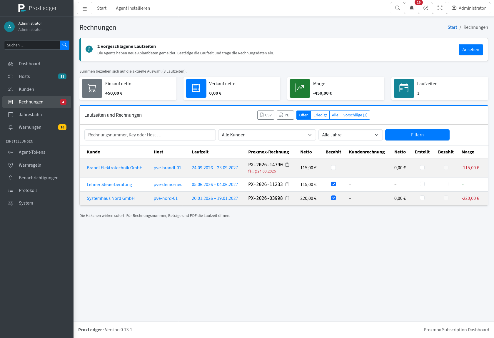

In der Tabelle lassen sich die drei Häkchen direkt setzen:

- **Proxmox bezahlt** – setzt zugleich das Bezahldatum.
- **Kundenrechnung erstellt** – gibt es noch keine Rechnung, legt das Häkchen eine ohne Nummer an; Nummer
  und Betrag trägst du später nach.
- **Vom Kunden bezahlt**

Für Details die Laufzeit öffnen:

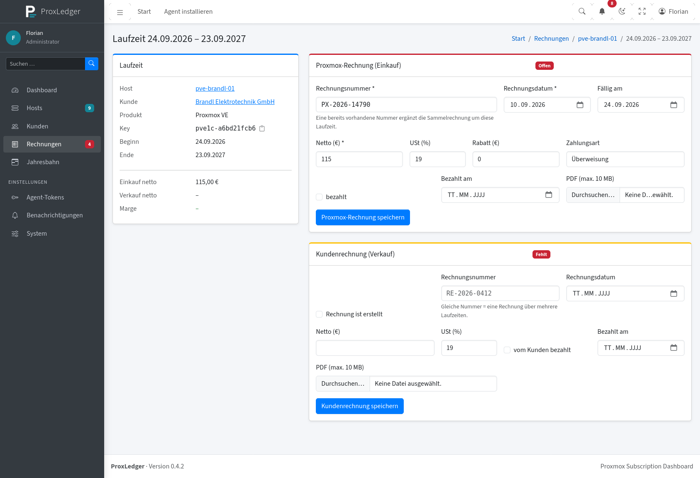

Dort stehen beide Rechnungen mit Nummer, Datum, Fälligkeit, Beträgen, Zahlungsart und PDF-Anhang. Ein
Vorschlag lässt sich hier bestätigen oder verwerfen; mit dem Erfassen einer Proxmox-Rechnung gilt er
automatisch als bestätigt.

### Sammelrechnungen

Eine Proxmox-Bestellung umfasst oft mehrere Keys, eine Kundenrechnung oft mehrere Hosts. Dafür braucht es
keinen eigenen Dialog: **Trägst du bei einer zweiten Laufzeit dieselbe Rechnungsnummer ein, wird sie als
weitere Position an die bestehende Rechnung gehängt.** Der Rechnungsbetrag ist immer die Summe der
Positionen und wird automatisch nachgeführt.

### Jahresbahn

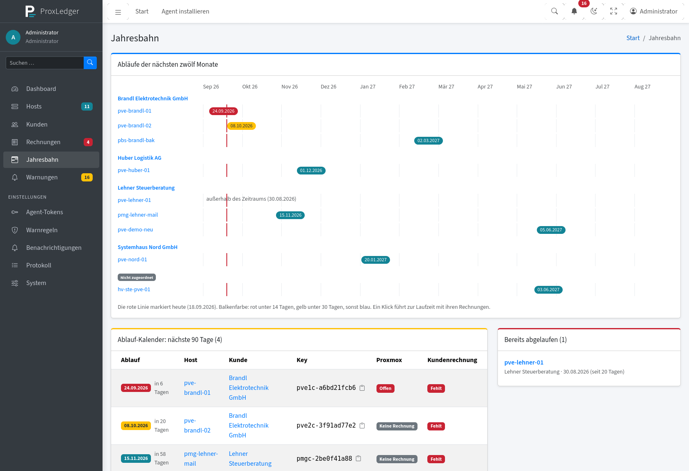

Die Jahresbahn zeigt zwölf Monate mit einer Linie für „heute“, gruppiert nach Kunde. Darunter stehen die
Abläufe der nächsten 90 Tage und die bereits abgelaufenen Subscriptions.

---

## 7. Warnungen

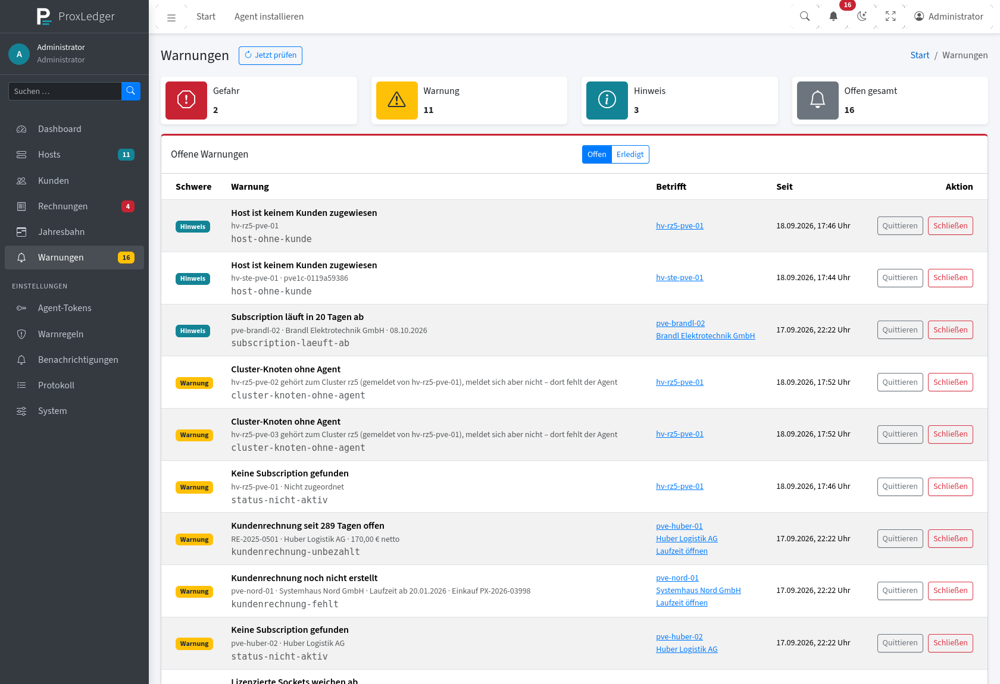

Zehn Regeln laufen stündlich und zusätzlich nach jedem eingehenden Report:

| Regel | Meldet |
|---|---|
| Ablauf | Subscription läuft in 30, 14 oder 7 Tagen ab |
| Status | Subscription ist abgelaufen, ungültig, ausgesetzt oder fehlt |
| Sockets | lizenzierte und physische Sockets weichen ab |
| Keine Meldung | Host meldet sich seit über 48 Stunden nicht |
| Server-ID | Server-ID hat sich geändert (Hardwaretausch oder Neuinstallation) |
| Key mehrfach | derselbe Key wird von mehreren Hosts gemeldet |
| Ohne Kunde | Host ist keinem Kunden zugewiesen |
| Proxmox-Rechnung | unbezahlt und in sieben Tagen fällig oder überfällig |
| Kundenrechnung fehlt | Einkauf erfasst, Verkauf noch nicht erstellt |
| Kundenrechnung offen | seit über 30 Tagen nicht bezahlt |

Eine Warnung wird genau einmal geöffnet und **schließt sich selbst**, sobald die Ursache behoben ist.
*Quittieren* markiert sie als gesehen, *Schließen* beendet sie von Hand – besteht die Ursache weiter,
kommt sie beim nächsten Durchlauf zurück.

Schwellwerte und Ein-/Ausschalter stehen unter *Einstellungen → Warnregeln*:

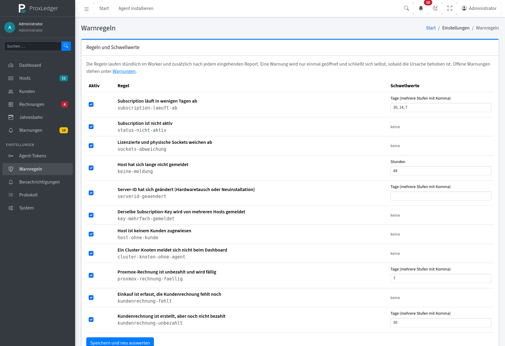

Mehrere Stufen werden mit Komma angegeben, etwa `30, 14, 7`. Nach dem Speichern wird sofort neu
ausgewertet.

---

## 8. Benachrichtigungen einrichten

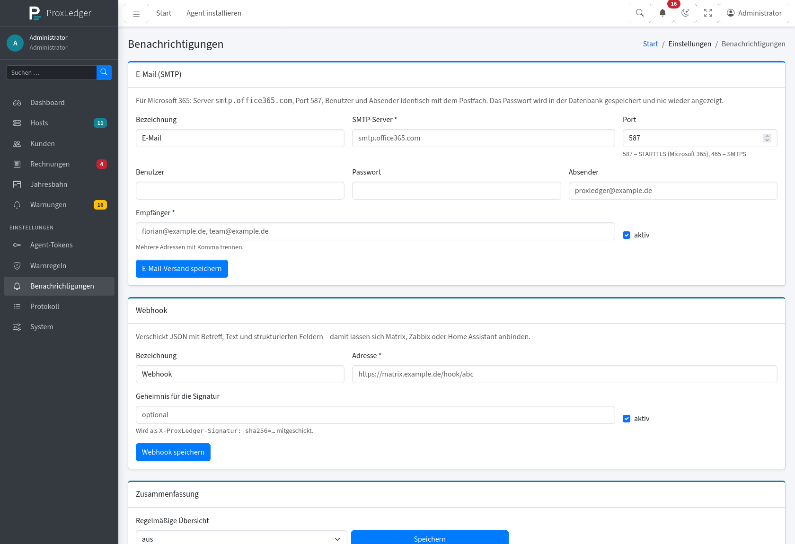

**E-Mail über Microsoft 365:** Server `smtp.office365.com`, Port 587, Benutzer und Absender identisch mit
dem Postfach. Das Passwort wird gespeichert und nie wieder angezeigt; ein leeres Feld beim Speichern lässt
den bisherigen Wert stehen.

**Webhook:** beliebige Adresse, die JSON entgegennimmt – damit lassen sich Matrix, Zabbix oder Home
Assistant anbinden. Mit hinterlegtem Geheimnis kommt die Signatur `X-ProxLedger-Signatur: sha256=…` mit,
damit der Empfänger die Echtheit prüfen kann.

**Zusammenfassung:** täglich oder wöchentlich um 07:00 Uhr mit offenen Warnungen, Rechnungspunkten und
bald ablaufenden Subscriptions.

Über *Test senden* lässt sich der Weg sofort prüfen; das Ergebnis steht im Versandprotokoll darunter.
Zu jeder Warnung wird nur einmal benachrichtigt. Schlägt der Versand fehl, wird er beim nächsten Durchlauf
erneut versucht.

---

## 9. Exporte

| Ansicht | CSV | PDF |
|---|---|---|
| Hosts | ✓ | ✓ |
| Kunden | ✓ | ✓ |
| Einzelner Kunde | – | ✓ (Anlage für Kundenunterlagen) |
| Rechnungen | ✓ | ✓ |

Alle Exporte übernehmen die gerade aktiven Filter und enthalten sämtliche Treffer, nicht nur die
angezeigte Seite. CSV kommt als UTF-8 mit BOM und Semikolon – Excel öffnet die Datei ohne Umwege, Umlaute
und Beträge stimmen.

Die PDF-Ausgaben tragen das einfarbige Logo und eignen sich als Anlage für Kundenunterlagen oder als
Jahresliste für die Buchhaltung.

---

## 10. Sicherung und Aktualisierung

**Sichern:**

```bash
./deploy/backup.sh /var/backups/proxledger
```

Das Skript sichert Datenbank, hochgeladene PDFs und die `.env`. Für regelmäßige Sicherungen in die
Crontab eintragen:

```
30 2 * * * /opt/proxledger/deploy/backup.sh /var/backups/proxledger
```

**Zurückspielen:**

```bash
gunzip -c datenbank-20260917-023000.sql.gz | docker compose exec -T postgres psql -U proxledger proxledger
```

**Aktualisieren:**

```bash
cd /opt/proxledger
git pull
docker compose up -d --build
```

Migrationen laufen dabei automatisch.

> `APP_SECRET` unbedingt mitsichern: Ohne diesen Wert sind alle Sitzungen ungültig. Und beachte, dass eine
> Sicherung die Zugangsdaten für SMTP und Webhook im Klartext enthält – sie gehört entsprechend geschützt.

---

## 11. Fehlersuche

**Ein Host meldet sich nicht.**
Auf dem Host `proxledger-agent --test` ausführen. Kommt keine Antwort, prüfen, ob das Dashboard vom Host
aus erreichbar ist (Firewall, DNS) und ob der Host-Token noch gültig ist – unter *Einstellungen →
Agent-Tokens* steht, wann er zuletzt benutzt wurde. Liegen Dateien in `/var/lib/proxledger/spool/`,
wartet der Agent auf eine Verbindung und sendet später nach.

**Nach der Anmeldung lande ich wieder auf der Anmeldeseite.**
Dann passt `APP_URL` nicht zur tatsächlichen Adresse: Steht dort `https://`, das Dashboard läuft aber über
`http://`, verwirft der Browser das Sitzungs-Cookie. `APP_URL` korrigieren und neu starten.

**Eine Warnung taucht immer wieder auf.**
Das ist beabsichtigt: Warnungen beschreiben einen Zustand. Solange die Ursache besteht, öffnet die nächste
Auswertung sie erneut. Passt der Schwellwert nicht, lässt er sich unter *Einstellungen → Warnregeln*
ändern, oder die Regel wird abgeschaltet.

**Server-ID hat sich geändert.**
Nach Hardwaretausch oder Neuinstallation vergibt Proxmox eine neue Server-ID. Der Key muss dann im
Proxmox-Shop neu zugewiesen werden. ProxLedger behält den Host samt Historie – die alte und die neue
Server-ID stehen in der Detailansicht unter *Subscription-Historie*.

**Was ist wann passiert?**
*Einstellungen → Protokoll* zeigt jede Änderung mit Zeitpunkt, Aktion und Benutzer.

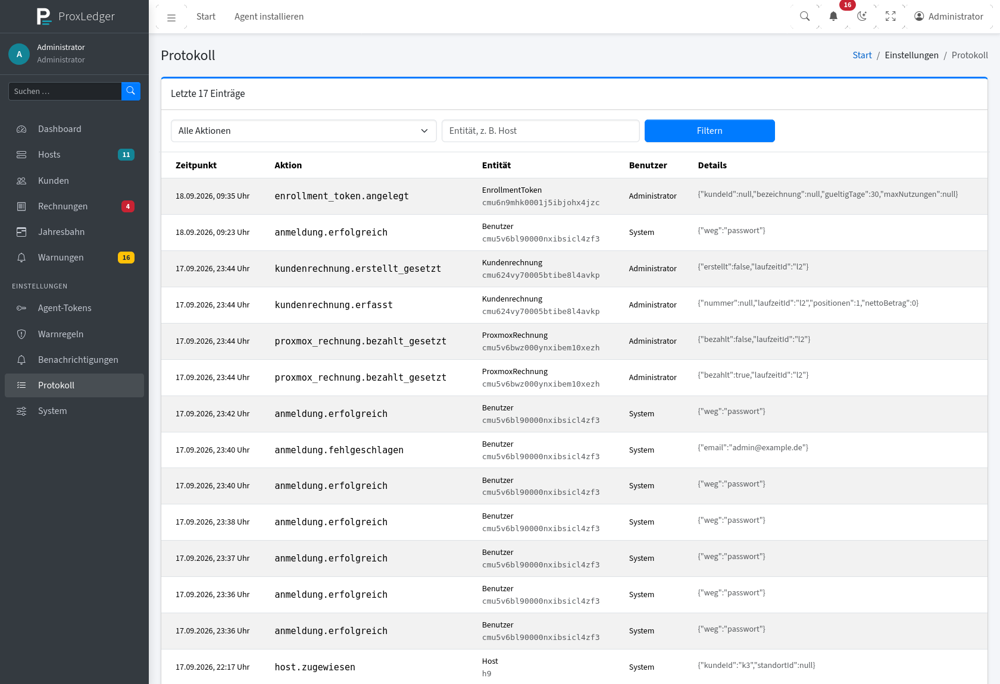

---

## Anhang: dunkles Design und Mobilansicht

Das Dashboard folgt der Einstellung des Betriebssystems und lässt sich über das Mondsymbol in der
Kopfleiste umschalten.

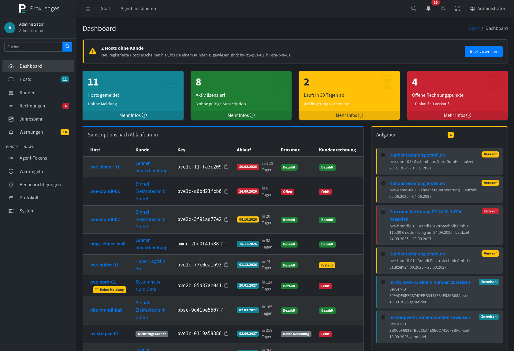

Auf dem Handy klappt die Seitenleiste ein, und die großen Tabellen blenden gestaffelt Spalten aus, sodass
Host, Kunde, Status und Ablauf ohne seitliches Scrollen sichtbar bleiben.

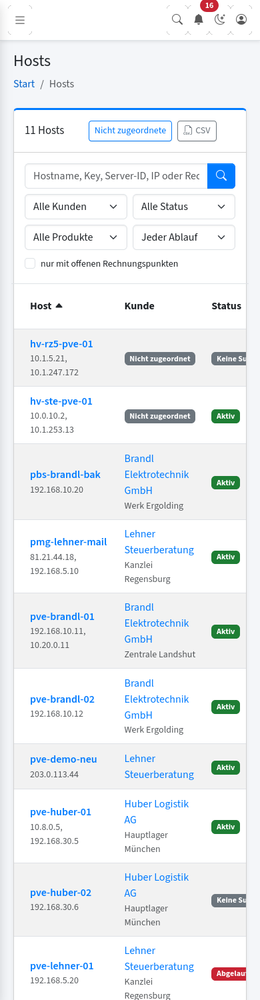

---

*Die Bilder in diesem Handbuch entstehen mit `npm run screenshots -- --alle` aus einer laufenden
Installation mit Beispieldaten und sollten vor jeder Veröffentlichung aufgefrischt werden.*
